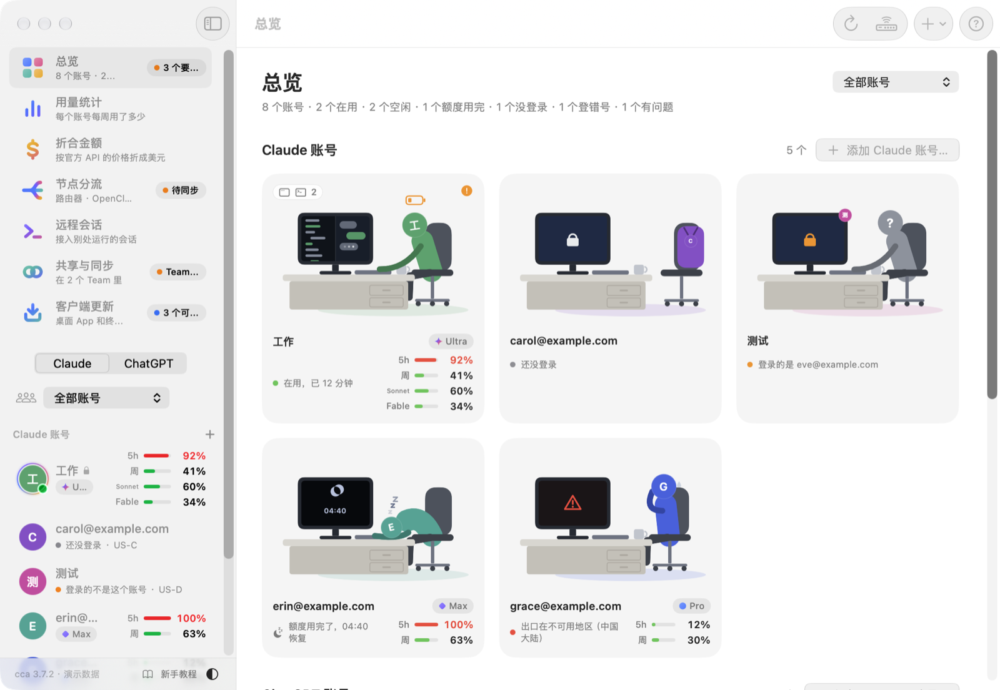
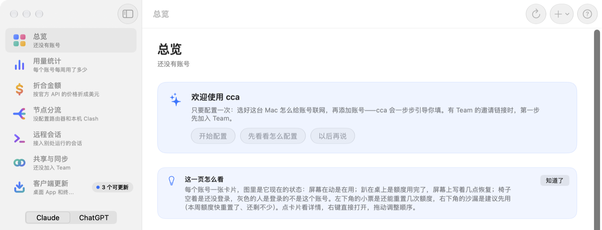
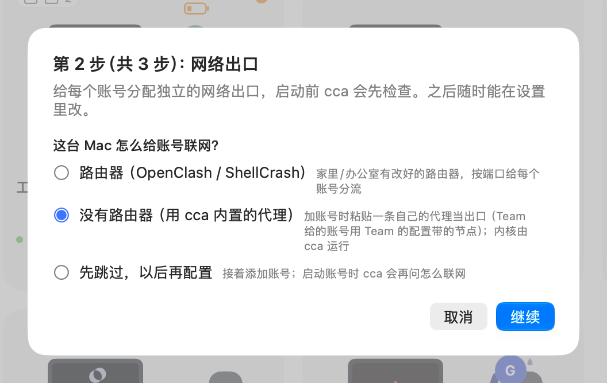
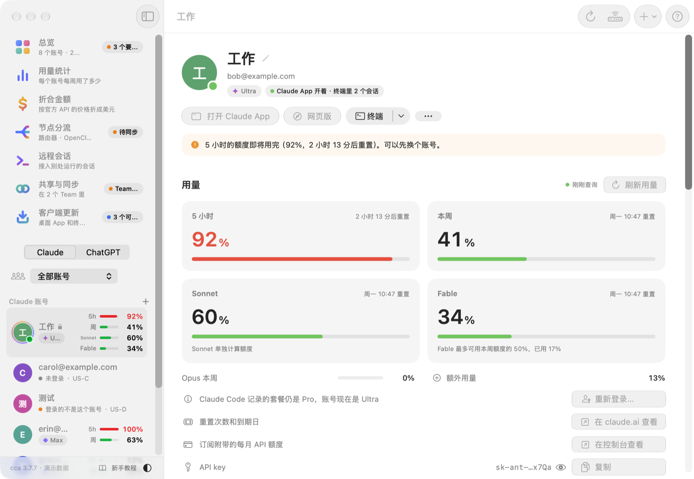

# cca: several Claude, ChatGPT and Antigravity accounts on one Mac

[中文](README.md) | **English**

Got more than one Claude account (say, a personal one and a work one)? cca keeps them apart on the same Mac: each account signs in on its own and always goes online through its own fixed network exit, while your chat history, memory and settings stay shared. Switch accounts and keep working: no signing out and back in, no accounts getting mixed up. OpenAI's Codex (ChatGPT accounts) and Google's Antigravity work the same way.

> **Note:** cca's command line and app are in **Simplified Chinese** only for now. Button names below are quoted in Chinese, with the English meaning in parentheses.



## What it does

- **Separate sign-ins**: every account has its own login, and they don't affect each other. Works with Claude Code, Codex and Antigravity (`agy`) in the terminal, the Claude and ChatGPT desktop apps, and the web (each account gets its own Chrome window).
- **Separate network exits**: each account always goes online through the proxy node you choose, so exit IPs never mix. At home it goes through your router; away from home cca switches to its built-in proxy.
- **Shared work**: chat history, memory, settings, skills, plugins and MCP servers are shared by all accounts. Switch accounts in the middle of a task and carry on.
- **Usage at a glance**: how much of each account's 5-hour and weekly quota is used, and when it resets. The app also nudges you to use accounts whose weekly quota resets soon with plenty left.
- **Checks before launch**: where the exit is, how clean the IP is, whether the right account is signed in. If something is wrong, cca stops or asks you first.
- **Third-party APIs as accounts**: any service compatible with the Anthropic API, with its URL and key, can sit next to your official accounts.

## What you need

- A Mac. The app (cca App) needs macOS 26 or later; older macOS versions and Linux use the command line.
- Google Chrome: sign-ins and the web version open in it.
- A network exit for your accounts, i.e. the IP address websites see for that account. cca doesn't provide proxies; bring your own, any one of these (not needed if you only use third-party API accounts over a direct connection):
  - a router at home or in the office running **OpenClash** or **ShellCrash** (a "side router"), with SSH enabled. ShellCrash needs version 1.9 or later with the Meta (mihomo) core, plus ruby on the router (`opkg install ruby ruby-yaml`; OpenClash ships with it);
  - a proxy of your own: `socks5://…`, `http://…`, or a vmess, vless, ss, trojan, hysteria2 or tuic share link;
  - an invite link from a Team admin (the Team provides the nodes).
- No `claude`, `codex` or `agy` command yet? No problem: cca can install them with the official installers (in the app, click a button such as 「安装 claude 命令…」 (Install the claude command…) on the account page; on the command line, cca offers when one is needed).

## Install

Open Terminal, paste this line and press Return:

```sh
curl -fsSL https://github.com/rivia7/claude-accounts/releases/latest/download/install.sh | bash
```

- **macOS**: when it finishes, the cca App opens. Set it up as described in the next section. On macOS versions before 26, or if the app couldn't be installed, cca asks its questions in the terminal instead (see "Setting up in the terminal" below).
- **Linux**: right after installing, the same command asks a few questions in the terminal; just answer them (see "Setting up in the terminal" below).
- If the installer asks whether to add `~/.local/bin` to your PATH, say yes; then open a new terminal tab (on Linux, log in again) before typing `cca`.
- Already installed? Running the line again repairs or reinstalls cca; your accounts and settings are kept.

<details>
<summary>Want to verify the signature yourself first?</summary>

```sh
curl -fsSL -o /tmp/cca     https://github.com/rivia7/claude-accounts/releases/latest/download/cca
curl -fsSL -o /tmp/cca.sig https://github.com/rivia7/claude-accounts/releases/latest/download/cca.sig
echo 'cca-release ssh-ed25519 AAAAC3NzaC1lZDI1NTE5AAAAICxClUySZa2aVx7s6HRzufgJ49ad44smTnmkzDI/Osex' > /tmp/cca.allowed
ssh-keygen -Y verify -f /tmp/cca.allowed -I cca-release -n cca-release -s /tmp/cca.sig < /tmp/cca
bash /tmp/cca install --gui    # on Linux, leave out --gui
```

Release key fingerprint: `SHA256:/JDnxJ7oMpg5H5K8rBbhsRo6sKoL65IaVLtQGeGrIZQ`. The one-line installer runs the same check.

</details>

## First-time setup

The first time you open the cca App, a welcome card sits at the top of the overview. Click 「开始配置」 (Start setup), or 「先看看怎么配置」 (See how it works) if you'd like a walkthrough first:



Setup takes three steps. You can stop at any point and continue later from the overview:

1. **Do you have a Team invite link?** If not, choose 「否」 (No) and use just your own accounts.
2. **How should this Mac get your accounts online?**
   - **「路由器」 (Router)**: enter the router's address and its root password once (used only to install a login key, never saved), then tick the nodes your accounts may use. The first time, OpenClash / ShellCrash has to reload its configuration, which takes about 20 seconds and briefly drops new connections on your local network; cca asks before doing it;
   - **「没有路由器」 (No router)**: use cca's built-in proxy. In the next step, when you pick the account's exit node, choose the last item, 「自定义代理…」 (Custom proxy…), and paste your proxy;
   - **「先跳过」 (Skip for now)**: set it up later from the 「＋」 button in the toolbar. Without a router or a Team, you'll still need to paste a proxy when you add an account.

   

3. **Add an account**: pick which kind (Claude Code, Codex or Antigravity; you can add one before its command is installed and install it from the account page later), then enter its email, an optional alias, and pick an exit node. To add more accounts later, use the 「＋」 button in the toolbar.

A newly added account isn't signed in yet: click its card in the overview to open the account page, then click 「登录…」 (Sign in…). cca opens a terminal window and the sign-in page in a Chrome window just for that account, with the email already filled in; follow the prompts. Once signed in, the account page shows usage and the network exit, and buttons such as 「打开 Claude App」 (Open Claude App), 「网页版」 (Web) and 「终端」 (Terminal) get you going:



At the bottom left of the app, 「新手教程」 (Tutorial) walks you through each page with pictures.

**Setting up in the terminal** (`cca install`): on a machine with a working direct connection, it asks whether to set up a router (address, root password, which nodes to allow) and then adds your first account (pick which kind first: Claude Code, Codex or Antigravity; if its command isn't installed yet, it offers to install it); on a server without one, it uses cca's built-in proxy instead, first asking for a Team invite link and, if you have none, for a proxy of your own. On a Mac's command line, the first time you use an account (`cca @alias`), cca opens that account's own Chrome window so you can sign in.

## Everyday use

Type `cca` in a terminal, pick an account and press Return; Claude Code starts with that account:

```text
选择 Claude 账号    ↑↓ 移动 · 回车确认 · 数字键直接选 · q 退出

  ❯ 工作   work@example.com   已登录     US-A   5h 13% · 周 41%   · 上次使用
    个人   me@example.com     未登录     US-B
    kimi   api.example.com    API        直连
    ＋ 添加新账号
    ＋ 添加第三方 API 账号
    退出
```

<sub>In the menu: 选择 Claude 账号 = choose a Claude account; ↑↓ 移动 · 回车确认 · 数字键直接选 · q 退出 = ↑↓ move · Return select · number keys jump · q quit; 已登录 / 未登录 = signed in / not signed in; 周 = week; 直连 = direct; 上次使用 = last used; ＋ 添加新账号 = add an account; ＋ 添加第三方 API 账号 = add a third-party API account; 退出 = quit.</sub>

The cursor starts on the account you used last, so most of the time you just press Return. Common commands (`work` is an account's alias here):

| To… | Run |
| --- | --- |
| Start with a particular account | `cca @work` (its alias, email, or the first few letters) |
| Add an account | `cca add` |
| See every account's usage | `cca usage` |
| List all accounts | `cca ls` |
| Open the account's web version | `cca web work` |
| Open the account's Claude App | `cca app work` |
| Rename an account | `cca rename work new-alias` |
| Switch nodes, edit the account list | `cca edit` |
| Sign in again | `cca login work` |
| Check every account's exit | `cca check` |
| Remove an account | `cca rm work` |
| Open the app (installs it if needed) | `cca gui` |
| See all commands | `cca help` |

**Codex and Antigravity** work the same way: put `codex` or `agy` in front, or use the shortcuts `cxa` and `aga`:

```sh
cca codex add     # add a ChatGPT account (Codex)
cxa @work         # start codex with that account (cxa = cca codex)
cca agy add       # add a Google account (Antigravity)
aga @work         # start agy with that account (aga = cca agy)
```

## More features

- **Third-party API accounts**: run `cca add api` and enter the API URL (the `ANTHROPIC_BASE_URL` from your provider's docs), the API key and, optionally, a model; then choose a direct connection or a node. Keys are stored in the macOS Keychain; change one with `cca key <alias>`. For Codex, use `cca codex add api` (the service must support OpenAI's Responses API).
- **One desktop app per account**: `cca app work` opens the Claude App with that account's own profile and exit, and `cca codex app work` does the same for the ChatGPT App. cca also puts a launcher for each account in `~/Applications` (for example "Claude work"), so Launchpad and Spotlight find them too. Your usual app is not affected.
- **Away from home**: when the router can't be reached, cca switches to its built-in proxy (a mihomo core) and every account keeps its own node; your system proxy and DNS are left alone. Run `cca local setup` before you leave, or let cca ask the first time you start an account while out. Claude Code sessions, web pages and apps opened at home go through the router: close them when you leave and reopen them with cca.
- **Your own proxy**: bought a static IP or a similar proxy? Run `cca node use work` and paste its link; that account now goes online through it (except accounts whose node a Team has fixed). If you use a router, OpenClash / ShellCrash needs one restart (about 20 seconds) before the proxy works there; cca asks first.
- **Usage history and cost estimate**: the app shows how much quota your Claude and ChatGPT accounts used in each of the last 12 weeks, and converts the tokens each account used into US dollars at official API prices, so you can see which accounts work hardest (an estimate, not what you actually pay).
- **Remote sessions**: after `cca remote on`, sessions you start in a terminal keep running when the terminal closes or SSH drops; `cca remote attach` brings you back (to step away, press `Ctrl-\` then `d`). Pair two machines in the same Team (`cca remote pair` / `cca remote join`) to carry on with a session from the other machine. The Team's server relays it, encrypted end to end, so the server can't read it. From the cca app on an iPhone, or from another paired machine, you can also start a new session from a template on this machine, picking which of this machine's accounts it uses (`cca remote template add` creates one, `cca remote allow <phone or machine> launch on` turns it on; on the other machine, run `cca remote launch`). On a Mac, use the app's 「远程会话」 (Remote sessions) page.
- **Done / waiting notifications**: when a Codex or Antigravity session started by cca finishes a turn or needs your confirmation, this Mac shows a notification (set `"popup": false` in `~/.cca/config.json` to turn it off). In a remote session these, like Claude Code's, also go to the other machine and the phone attached to it.
- **Linux servers**: install with the same line (x86_64 or arm64, OpenSSH 8.1 or later; if anything else is missing it tells you how to install it) and use the command line. Servers without a working direct connection use cca's built-in proxy. To sign in, `cca login work` prints a command to run on your Mac, which opens the sign-in page there; then paste the code back on the server.
- **Mail helper** (Mac only, Claude accounts only): forward your Claude accounts' mailboxes to one Gmail address and run `cca mail setup` (it needs a Gmail app password and only reads mail). When a sign-in email arrives, cca opens its link in that account's Chrome.
- **Client updates**: the app's 「客户端更新」 (Client updates) page checks the Claude and ChatGPT desktop apps, Claude Code and Codex for new versions, verifies their signatures and installs them once you confirm.

## Team

A Team is a group of devices plus one shared setup: which accounts to use, and which node each account goes through. The device that creates the Team is its admin and sends each device an invite link; once a device joins, the Team's accounts appear on it with their exits fixed. To keep your own devices in sync, create a Team of your own.

- **Join**: in the app, open 「共享与同步」 (Sharing & sync) and click 「粘贴邀请链接…」 (Paste invite link…), or run `cca team join`. Each invite works for one device only.
- **Create one**:
  1. run `cca team new <name>` (in the app: 「新建 Team…」 (New Team…)); this device becomes the admin;
  2. deploy the Team's sync server to a Linux cloud server with `cca team deploy <name> root@<server>`, then open the ports it lists at the end in your cloud provider's firewall. No server? `cca team hosted <name>` walks you through deploying to Railway, a hosting platform (servers there don't relay remote sessions);
  3. invite each device: `cca team invite <name> <device>`. The link is that device's key: share it privately, like a password, and never in a group chat.
- The server stores ciphertext and can't see emails, sign-ins, keys or the setup itself. It only sees things like device names, public IP addresses and how many sessions are open.
- For everything else: `cca team help`.

## Is it safe?

- **Your credentials stay with the official tools**: Claude Code, Codex and Antigravity sign in and store their credentials themselves. cca never stores or forwards your credentials and never touches the access tokens; it only reads which email and plan are signed in, to make sure it's the right account. Usage is checked by those tools too, without sending a message or using any quota.
- **Passwords and keys**: the router password is used once and never saved. Third-party API keys are stored in the Keychain (on Linux, in files only you can read) and never appear in command-line arguments or environment variables.
- **Checks before launch**:
  - stops if the exit is in a region the provider doesn't serve (for example mainland China or Hong Kong);
  - asks first if the IP's reputation is poor, and warns about possible DNS / WebRTC leaks;
  - won't launch if a different email is signed in, or if the shared `~/.claude/settings.json` contains settings that would mix accounts up (such as `ANTHROPIC_BASE_URL` or a proxy); it names them, and `cca settings fix` removes them. The same kind of variables exported in your shell are simply not passed on.
- **Separate device IDs**: each account keeps its own client device identifiers, unchanged when you sign in again, rename the account or switch nodes. Browser and hardware fingerprints are beyond what this covers.
- **Signed releases only**: both installing and auto-updating verify the release signature.

## Updating and uninstalling

- **Auto-update**: cca checks once a day in the background and switches to the new version the next time it starts; the app follows. `cca update` updates right away, `cca update --rollback` goes back to the previous version, and `cca update off` turns auto-update off.
- **Betas**: marked Pre-release on [Releases](https://github.com/rivia7/claude-accounts/releases) and never installed automatically. To try one, run `cca update X.Y.Z-beta.N`.
- **Uninstall**: first quit each account's desktop apps and Chrome windows and the cca App, and end any remote sessions (otherwise it stops without touching anything); then run `cca uninstall`. It lists what it will do; once you confirm, it signs every account out, removes its setup from the router and deletes cca and `~/.cca`, after backing up your configuration to `~/cca-backup-<date>.tar.gz` (credentials excluded). Your own `~/.claude`, `~/.codex` and `~/.gemini`, and the `claude`, `codex` and `agy` commands, are left alone.

## FAQ

**I switched accounts. How do I continue the conversation?**
When you quit Claude Code it prints the session ID. In the same project folder, run `cca @other-account --resume <session ID>`.

**I closed the app's window. Is it still running?**
Yes. The cca App normally lives in the menu bar at the top of the screen, so usage keeps updating and the built-in proxy keeps running. To quit for good, click 「退出」 (Quit) in the menu bar icon's panel.

**It says a port is unreachable (“端口不通”; in the app, “端口无法连接”).**
In the app, click 「同步路由器」 (Sync router) in the toolbar. On the command line, run `cca router status` to see the ports on the router and `cca router sync` to sync them again.

**It says the exit IP's reputation is low.**
Run `cca edit` and give that account another node.

**Why does OpenClash / ShellCrash need a reload the first time?**
cca has to create a set of ports on the router, one per account, in blocks of 8. After that, as long as you stay within 8 accounts and the allowed nodes don't change, adding accounts or switching nodes needs no reload; if one is ever needed, cca asks first.

**Will it still work after OpenClash / ShellCrash updates?**
Yes. cca keeps its files on the router in `/etc/cca` and puts its hooks back after an update or reinstall.

**Can I download the cca App from the Releases page?**
Don't download `cca-app.zip` with a browser: the app isn't notarized by Apple, so macOS will block it. Install it with `cca gui`, which verifies its signature.

## Development

`cca` is a bash script followed by a helper program written in Rust (source in `cli/`, which also contains the Team sync server, in `cli/src/server/`); `macos/` holds the SwiftUI cca App, and `server/` the sync server's install script and wire-format docs. The developer docs are in Chinese.

- Full regression run: `bash tests/regress.sh` (macOS only; fake router, claude and GitHub, no network, about 12 minutes)
- Tests on Linux: `bash tests/linux.sh` (needs network)
- Helper program: `cd cli && cargo build --release --locked && cargo test --locked`
- cca App: `bash macos/build.sh`, `bash macos/test.sh` (Apple's command line tools are enough; no Xcode needed)
- Developer docs: [CLAUDE.md](CLAUDE.md), [docs/dev/](docs/dev/), [macos/PROTOCOL.md](macos/PROTOCOL.md), [server/README.md](server/README.md)

## License

[MIT](LICENSE)
