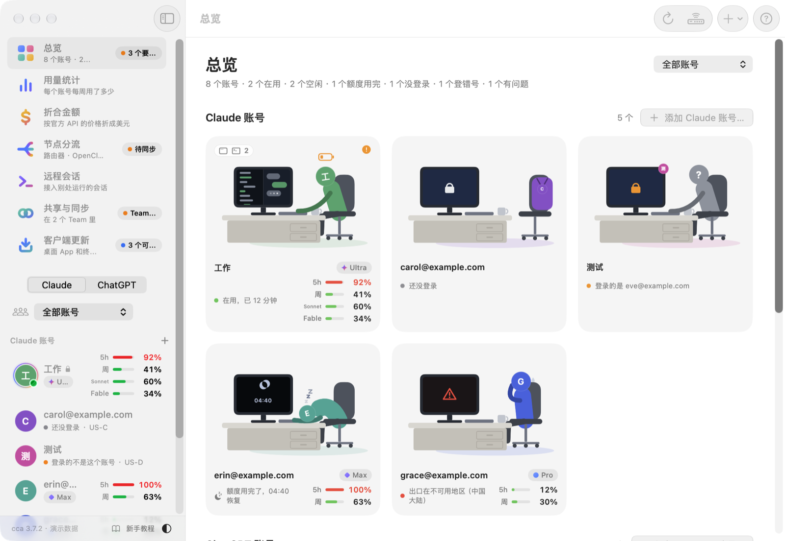
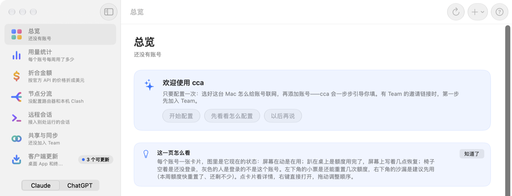
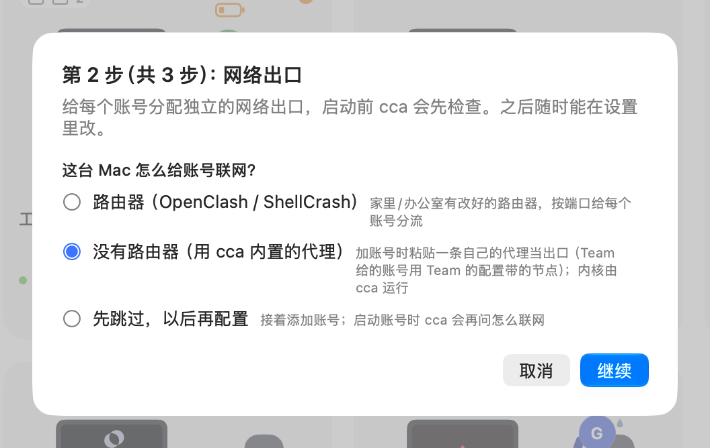
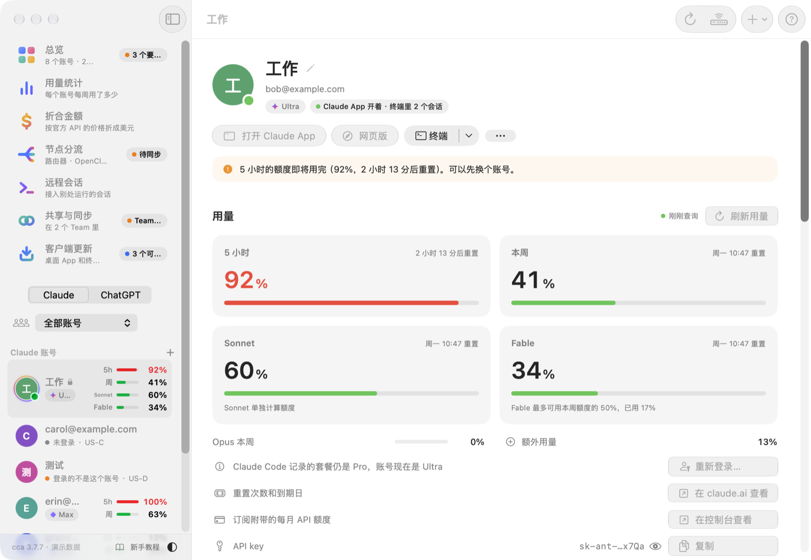

# cca：一台 Mac 同时用多个 Claude、ChatGPT、Antigravity 账号

**中文** | [English](README.en.md)

有好几个 Claude 账号（比如个人号和工作号）？cca 让它们在同一台 Mac 上各用各的：每个账号单独登录、从自己固定的网络出口上网，对话记录、记忆和设置却共用一份。换个账号接着干，不用退出重登，也不会串号。OpenAI 的 Codex（ChatGPT 账号）和 Google 的 Antigravity 也一样。



## 它能做什么

- **各自登录**：每个账号有自己的登录，互不影响。终端里的 Claude Code、Codex、Antigravity（`agy`），Claude 和 ChatGPT 的桌面 App，还有网页版（每个账号一个专属的 Chrome 窗口）都支持。
- **各走各的出口**：每个账号固定从你指定的代理节点上网，出口 IP 不混用。在家走路由器，出门在外自动改走 cca 自带的代理。
- **工作资料共用**：对话记录、记忆、设置、技能、插件、MCP，所有账号共用一份。聊到一半换个账号，接着聊。
- **用量一眼看清**：每个账号 5 小时、本周的额度用了多少、什么时候重置（Claude、Antigravity 的是经 cca 开的会话里记下的，好久没用的账号显示上次记下的）。App 还会提醒你先用本周快重置、还剩不少的账号。
- **启动前先检查**：出口在哪个地区、IP 干不干净、登录的是不是这个账号；有问题会停下，或者先问你。
- **第三方 API 也能当账号**：兼容 Anthropic 接口的服务，填上地址和 key，就能和官方账号放在一起选。

## 需要准备什么

- 一台 Mac。图形界面（cca App）要 macOS 26 或更新；更老的 macOS 和 Linux 用命令行。
- Google Chrome：登录和网页版都在它里面打开。
- 给账号上网的出口，也就是网站看到的这个账号的 IP。cca 不提供代理，要你自己准备，下面任选一种（只用直连的第三方 API 账号的话可以不要）：
  - 家里或办公室有一台装了 **OpenClash** 或 **ShellCrash** 的路由器（常说的旁路由），开着 SSH。ShellCrash 要 1.9 或更新、用 Meta（mihomo）内核，路由器上还要装 ruby（`opkg install ruby ruby-yaml`，OpenClash 自带）；
  - 一条你自己的代理：`socks5://…`、`http://…`，或者 vmess、vless、ss、trojan、hysteria2、tuic 的分享链接；
  - Team 管理员发给你的邀请链接（节点由 Team 配好）。
- `claude`、`codex`、`agy` 命令没装也没关系：cca 能用官方安装脚本帮你装（App 的账号页里点「安装 claude 命令…」这类按钮，命令行里用到时也会问）。

## 安装

打开「终端」，粘贴下面这一行，回车：

```sh
curl -fsSL https://github.com/rivia7/claude-accounts/releases/latest/download/install.sh | bash
```

- **macOS**：装好后自动打开 cca App，照着下一节配置。macOS 26 以前的版本，或者 App 没装上时，改在终端里问几个问题（见下面「在终端里配置」）。
- **Linux**：这一行装完，接着在终端里问几个问题，照提示回答就行（见下面「在终端里配置」）。
- 安装时如果问要不要把 `~/.local/bin` 加进 PATH，选是；装好后新开一个终端标签（Linux 上要重新登录），才能直接输入 `cca`。
- 已经装过的，再运行一次就是修复或重装，账号和配置都会保留。

<details>
<summary>想先自己校验签名再安装？</summary>

```sh
curl -fsSL -o /tmp/cca     https://github.com/rivia7/claude-accounts/releases/latest/download/cca
curl -fsSL -o /tmp/cca.sig https://github.com/rivia7/claude-accounts/releases/latest/download/cca.sig
echo 'cca-release ssh-ed25519 AAAAC3NzaC1lZDI1NTE5AAAAICxClUySZa2aVx7s6HRzufgJ49ad44smTnmkzDI/Osex' > /tmp/cca.allowed
ssh-keygen -Y verify -f /tmp/cca.allowed -I cca-release -n cca-release -s /tmp/cca.sig < /tmp/cca
bash /tmp/cca install --gui    # Linux 上不用 --gui
```

发布公钥的指纹：`SHA256:/JDnxJ7oMpg5H5K8rBbhsRo6sKoL65IaVLtQGeGrIZQ`。一键安装脚本也会做同样的校验。

</details>

## 第一次配置

第一次打开 cca App，总览顶上有一张欢迎卡片。点「开始配置」；想先看看流程，点「先看看怎么配置」：



配置分三步，中途关掉也行，随时能从总览接着来：

1. **有没有 Team 的邀请链接**：没有就点「否」，只用你自己的账号。
2. **这台 Mac 怎么给账号联网**：
   - **路由器**：填路由器的地址，输一次 root 密码（只用来装一把免密登录的钥匙，不会保存），再勾选允许账号用的节点。第一次要让 OpenClash / ShellCrash 重新加载一次配置，大约 20 秒，这期间局域网里新开的网络连接会断一下，cca 会先问你；
   - **没有路由器**：用 cca 自带的代理。下一步给账号选出口节点时，选最后一项「自定义代理…」，粘贴你的代理；
   - **先跳过**：以后在工具栏的「＋」里再配。没有路由器、也没加入 Team 的话，添加账号时还是要粘贴一条代理。

   

3. **添加账号**：填登录邮箱，起个别名（可以不填），选一个出口节点。

加好的账号还没登录：在总览点它的卡片进入账号页，点「登录…」。cca 会开一个终端窗口，并用这个账号专属的 Chrome 打开登录页（邮箱已经填好），照提示登录就行。登录以后，账号页里能看用量和网络出口，点「打开 Claude App」「网页版」「终端」就能用：



App 左下角有「新手教程」，用图文讲每一页怎么看。

**在终端里配置**（`cca install`）：能直连的机器问要不要配置路由器（地址、root 密码、允许用的节点），再添加第一个账号；直连不通的服务器改用 cca 自带的代理，先问有没有 Team 的邀请链接，没有就粘贴你自己的代理。在 Mac 的命令行里第一次用某个账号（`cca @别名`）时，会自动打开它专属的 Chrome 窗口让你登录。

## 日常使用

在终端里输入 `cca`，选一个账号回车，就用这个账号启动 Claude Code：

```text
选择 Claude 账号    ↑↓ 移动 · 回车确认 · 数字键直接选 · q 退出

  ❯ 工作   work@example.com   已登录     US-A   5h 13% · 周 41%   · 上次使用
    个人   me@example.com     未登录     US-B
    kimi   api.example.com    API        直连
    ＋ 添加新账号
    ＋ 添加第三方 API 账号
    退出
```

光标默认停在上次用的账号上，平时直接回车就行。常用命令：

| 想做什么 | 命令 |
| --- | --- |
| 直接用某个账号启动 | `cca @工作`（写别名、邮箱或开头几个字都行） |
| 添加账号 | `cca add` |
| 看各账号的用量 | `cca usage` |
| 列出所有账号 | `cca ls` |
| 打开账号的网页版 | `cca web 工作` |
| 打开账号的 Claude App | `cca app 工作` |
| 改别名 | `cca rename 工作 新别名` |
| 换节点、编辑账号表 | `cca edit` |
| 重新登录 | `cca login 工作` |
| 检查各账号的出口 | `cca check` |
| 删除账号 | `cca rm 工作` |
| 打开图形界面（没装就先装上） | `cca gui` |
| 看全部命令 | `cca help` |

**Codex 和 Antigravity** 的用法一样，前面加 `codex` 或 `agy`，也可以用简写 `cxa`、`aga`：

```sh
cca codex add     # 添加 ChatGPT 账号（Codex）
cxa @工作         # 用这个账号启动 codex（cxa 就是 cca codex）
cca agy add       # 添加 Google 账号（Antigravity）
aga @工作         # 用这个账号启动 agy（aga 就是 cca agy）
```

## 更多功能

- **第三方 API 账号**：运行 `cca add api`，填接口地址（服务商文档里的 `ANTHROPIC_BASE_URL`）、API key 和模型（可以不填），再选直连还是走节点。key 存在 macOS 钥匙串里，换 key 用 `cca key 别名`。Codex 用 `cca codex add api`（服务要兼容 OpenAI 的 Responses 接口）。
- **桌面 App 多开**：`cca app 工作` 用这个账号自己的资料和出口打开 Claude App，`cca codex app 工作` 打开 ChatGPT App。cca 还会在 `~/Applications` 里给每个账号放一个启动器（比如「Claude 工作」），从启动台、聚焦搜索里也能打开。你原来的 App 不受影响。
- **出门在外**：连不上路由器时，cca 自动改走自带的代理（mihomo 内核），每个账号照样走自己的节点，不改系统代理和 DNS。可以出门前先运行 `cca local setup` 配好，第一次在外面启动时 cca 也会问。在家里打开的 Claude Code、网页版和 App 走的是路由器，出门后要关掉，用 cca 重新打开。
- **用自己的代理**：买了静态 IP 这类代理，运行 `cca node use 工作` 粘贴链接，这个账号就改走它（Team 固定了节点的账号除外）。用着路由器的话，要重启一次 OpenClash / ShellCrash 才用得上（约 20 秒），cca 会先问你。
- **用量统计和折合金额**：App 里能看 Claude、ChatGPT 账号最近 12 周每周用了多少额度；还能把每个账号用掉的 token 按官方 API 的价格折成美元，看哪个账号用得多（只是折算，不是实际花费）。
- **远程会话**：运行 `cca remote on` 之后，在终端里启动的会话不怕终端关掉、SSH 断开，用 `cca remote attach` 接回去（离开时先按 `Ctrl-\` 再按 `d`）。同一个 Team 里的两台机器配对（`cca remote pair` / `cca remote join`）以后，还能在另一台上接着用：经 Team 的服务器中转，内容两头加密，服务器看不到。在 iPhone 上的 cca App 里还能照这台机器上的模板新建会话（`cca remote template add` 建模板，`cca remote allow 手机的名字 launch on` 打开）。Mac 上在 App 的「远程会话」页里操作。
- **做完了、在等你的通知**：cca 启动的 Codex、Antigravity 会话做完一轮、要你确认时，这台 Mac 上弹一个通知（不要的话在 `~/.cca/config.json` 里写 `"popup": false`）。会话放在远程会话里时，这些和 Claude Code 的一样推给接着它的另一台机器和手机。
- **Linux 服务器**：用同一行命令安装（x86_64 或 arm64，要 OpenSSH 8.1 以上，缺别的会告诉你怎么装），用命令行。直连不通的服务器用 cca 自带的代理。登录时 `cca login 工作` 会给出一行命令，在 Mac 上运行它打开登录页，再把验证码贴回服务器。
- **邮箱助手**（只在 Mac 上，只给 Claude 账号用）：把各个 Claude 账号的邮箱转发到同一个 Gmail，运行 `cca mail setup`（要 Gmail 的应用专用密码，只读不改）。登录时登录邮件一到，cca 就在这个账号的 Chrome 里打开里面的链接。
- **客户端更新**：App 的「客户端更新」页检查 Claude、ChatGPT 桌面 App 和 Claude Code、Codex 的新版本，验过签名、你确认以后再装。

## Team

Team 是一组设备加一份配置：用哪些账号、每个账号走哪个节点。建 Team 的设备是管理员，给每台设备发一个邀请链接；设备加入以后，Team 给的账号自动加进来，出口照配置固定。想让自己的几台设备之间同步账号，也是自己建一个 Team。

- **加入**：在 App 的「共享与同步」里点「粘贴邀请链接…」，或者运行 `cca team join`。一个邀请只能加入一台设备。
- **自己建一个**：
  1. 运行 `cca team new 名字`（App 里是「新建 Team…」），这台设备就是管理员；
  2. 把它的同步服务器部署到一台 Linux 云服务器上：`cca team deploy 名字 root@服务器`，再在云服务商的安全组里放行它最后列出的端口。没有服务器的话，`cca team hosted 名字` 带你部署到托管平台 Railway（这种不给远程会话做中转）；
  3. 给每台设备发邀请：`cca team invite 名字 设备名`。邀请链接就是那台设备的密钥，像密码一样私下发，别贴到群里。
- 服务器上存的是密文，看不到邮箱、登录、key 和配置的内容；它只看得到设备名、公网 IP、开着几个会话这类信息。
- 全部用法：`cca team help`。

## 安全吗

- **不碰登录凭证**：登录由 Claude Code、Codex、Antigravity 自己完成、自己保存。cca 不保存、不转发登录凭证，也不碰用来访问的 token，只读出登录的邮箱和套餐，核对登录的是不是这个账号。用量也不另外发请求去查：Claude Code、Antigravity 的额度是 cca 开的会话里它们自己给状态栏的，cca 记下来，没配自己状态栏的 Claude Code 会话里那一行写着账号和刚记下的用量（从不用 `claude -p`、`codex exec` 这类不开界面的模式，也不让经 cca 用）；ChatGPT 账号的让 Codex 自己去查。不发消息、不耗额度。
- **密码和 key**：路由器密码只用一次，不保存。第三方 API 的 key 存在钥匙串里（Linux 上是只有你能读的文件），不出现在命令行参数和环境变量里。
- **启动前检查**：
  - 出口在服务商不支持的地区（比如中国大陆、香港）时直接停下；
  - IP 纯净度太低时先问你；DNS / WebRTC 可能泄露时提示一句；
  - 登录成了别的邮箱，或者共享的 `~/.claude/settings.json` 里写了会让账号串号的配置（比如 `ANTHROPIC_BASE_URL`、代理）时不启动，并说清楚是哪几项，`cca settings fix` 能帮你去掉；shell 里 export 的同类变量，启动时直接不带进去。
- **设备标识分开**：每个账号有自己固定的客户端设备标识，重新登录、改别名、换节点都不变。浏览器和硬件层面的特征不在它管的范围里。
- **只装签了名的版本**：安装和自动更新都会校验发布签名。

## 更新和卸载

- **自动更新**：cca 每天在后台检查一次，下次启动时换上新版本，App 也跟着更新。`cca update` 马上更新，`cca update --rollback` 退回上一版，`cca update off` 关掉自动更新。
- **测试版**：在 [Releases](https://github.com/rivia7/claude-accounts/releases) 里标为 Pre-release，不会自动装；想试的话运行 `cca update X.Y.Z-beta.N`。
- **卸载**：先退出各账号的桌面 App 和专属的 Chrome 窗口、退出 cca App、结束远程会话（不然它会停下、什么都不动），再运行 `cca uninstall`。它先列出要做的事，你确认以后：各账号退出登录、清掉路由器上的配置、删掉 cca 和 `~/.cca`；删之前把配置备份到 `~/cca-backup-日期.tar.gz`（不含登录凭证）。你原来的 `~/.claude`、`~/.codex`、`~/.gemini` 和 `claude`、`codex`、`agy` 命令都不动。

## 常见问题

**换了账号，怎么接着刚才的对话？**
退出 Claude Code 时它会打印会话 ID。在同一个项目目录里运行 `cca @另一个账号 --resume <会话 ID>`。

**关掉 App 的窗口，它还在运行？**
是的。cca App 平时待在屏幕顶上的菜单栏里，用量照常更新，自带的代理也不停。要彻底退出，点菜单栏图标里的「退出」。

**提示“端口不通”（App 里是“端口连不上”）怎么办？**
在 App 里点工具栏的「同步路由器」；命令行里运行 `cca router status` 看路由器上的端口，`cca router sync` 重新同步。

**提示出口纯净度低怎么办？**
运行 `cca edit`，给这个账号换一个节点。

**为什么第一次要重新加载 OpenClash / ShellCrash？**
要在路由器上给账号建一组端口（每个账号一个，8 个一组）。之后只要账号不超过 8 个、可选节点没变，加账号、换节点都不用再加载；真要加载时 cca 会先问你。

**OpenClash / ShellCrash 升级以后还能用吗？**
能。cca 在路由器上的文件放在 `/etc/cca`，升级、重装以后会自动补回去。

**能从 Releases 页面下载 cca App 吗？**
别用浏览器下载 `cca-app.zip`：App 没有经过苹果公证，会被系统拦下。用 `cca gui` 安装，它会校验签名。

## 开发

`cca` 是一个 bash 脚本，后面接着 Rust 写的辅助程序（源码在 `cli/`，Team 的同步服务器也在里面：`cli/src/server/`）；`macos/` 是 SwiftUI 写的 cca App，`server/` 放同步服务器的安装脚本和线上格式说明。

- 全流程回归：`bash tests/regress.sh`（只在 macOS 上跑，路由器、claude、GitHub 全是假的，不联网，约 12 分钟）
- Linux 上的测试：`bash tests/linux.sh`（要联网）
- 辅助程序：`cd cli && cargo build --release --locked && cargo test --locked`
- cca App：`bash macos/build.sh`、`bash macos/test.sh`（只要苹果的命令行工具，不用 Xcode）
- 开发文档：[CLAUDE.md](CLAUDE.md)、[docs/dev/](docs/dev/)、[macos/PROTOCOL.md](macos/PROTOCOL.md)、[server/README.md](server/README.md)

## 许可证

[MIT](LICENSE)
